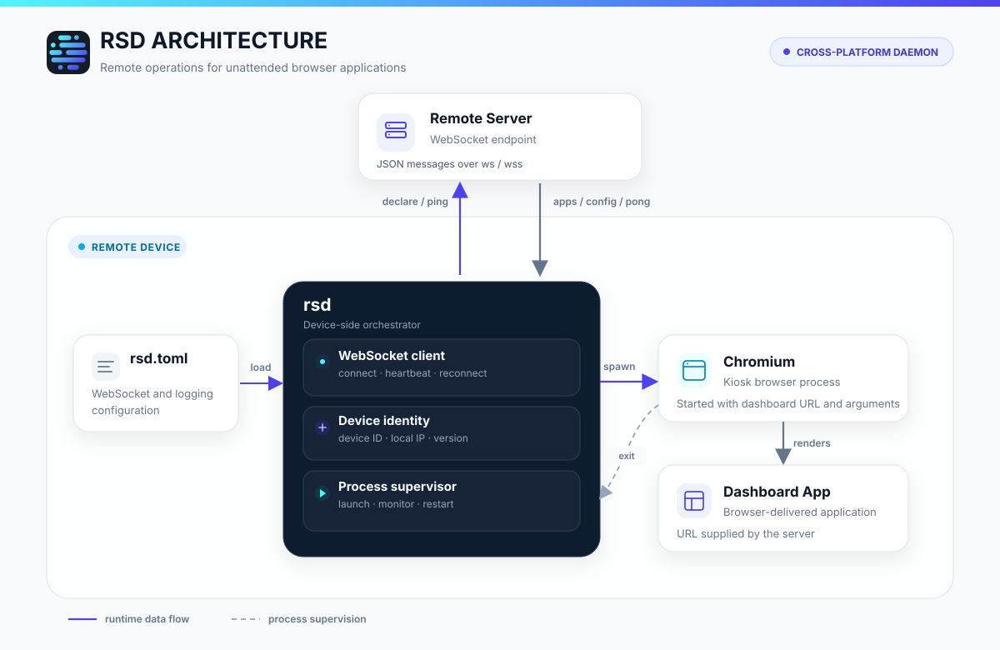

<div align="center">


### A cross-platform daemon for remote management and maintenance of browser-based apps and dashboards.

[](https://github.com/turingxlab/rsd/releases)
[](https://github.com/turingxlab/rsd/releases)
[](https://www.rust-lang.org/)
[](https://github.com/turingxlab/rsd/releases/latest)

<p align="center">
  <a href="./README.md"></a>
  <a href="./README_zh.md"></a>
</p>

</div>

## What is rsd?

`rsd` is a cross-platform daemon deployed on remote devices, primarily used for remote operations and maintenance of browser applications such as digital twins and visualization dashboards.

It maintains a WebSocket connection to the server, reports device information, and starts and manages browser applications according to the configuration delivered by the server.



## Core Capabilities

- **Device registration**: Reports the device ID, local IP address, and program version after connecting.
- **Stable connection**: Supports automatic reconnection and periodic heartbeats.
- **Remote application launch**: Receives application configuration from the server and starts the specified browser application.
- **Process supervision**: Monitors application status and restarts the application after it exits.
- **Remote screenshots**: Receives screenshot commands from the server, captures each display, and uploads the images to the server in PNG format.
- **Self-update**: Receives version information from the server, verifies the new binary, replaces itself, and restarts.
- **Cross-platform operation**: Supports Windows, macOS, and Linux.

If the application process exits unexpectedly, `rsd` retries startup up to 5 times. The retry count is reset after the application runs stably for 60 seconds.

## Quick Start

### Get the Program

Download the archive for your platform from [GitHub Releases](https://github.com/turingxlab/rsd/releases/latest). The extracted archive contains:

```text
rsd         # rsd.exe on Windows
rsd.toml
LICENSE
```

### Configuration File

By default, `rsd` reads `rsd.toml` from the same directory as the executable.

```toml
[server]
# Server hostname or IP, without the scheme, port, or path
addr = "rsd.example.com"
port = 443
tls = true

[http]
# API path prefix for screenshot and log uploads
path = "/device/rsd"

[websocket]
path = "/ws/rsd/cmd"
reconnect_interval_sec = 30
heartbeat_enabled = true
heartbeat_interval_sec = 30

[logging]
level = "info"
# output = "file"
# directory = "logs"
# rotation = "daily"
# max_log_files = 7
```

Main configuration options:

| Option | Default | Description |
| --- | --- | --- |
| `server.addr` | Required | Server hostname or IP |
| `server.tls` | `true` | `true` uses `wss`; `false` uses `ws` |
| `server.port` | `443` / `80` | Defaults to 443 with TLS enabled, or 80 with TLS disabled |
| `http.path` | `/device/rsd` | HTTP API path prefix for screenshot and log uploads; must be an absolute path without a host, query, fragment, backslash, or whitespace |
| `websocket.path` | `/device/rsd/cmd` | WebSocket path |
| `websocket.reconnect_interval_sec` | `30` | Reconnection interval in seconds |
| `websocket.heartbeat_enabled` | `true` | Whether to send heartbeats |
| `websocket.heartbeat_interval_sec` | `30` | Heartbeat interval in seconds |
| `logging.level` | `info` | Log level; the `RUST_LOG` environment variable takes precedence |
| `logging.output` | `console` | Output destination: `console` for terminal logs, or `file` for file logs only |
| `logging.directory` | `.rsd/logs` under the user's home directory | Optional custom log directory; relative paths use the process working directory |
| `logging.rotation` | `never` | Rotation period: `never`, `minutely`, `hourly`, `daily`, or `weekly` (Sunday at midnight UTC) |
| `logging.max_log_files` | Unset | Maximum number of retained log files, including the current file; must be positive; omitted means no automatic cleanup |

Local debugging connection example:

```toml
[server]
addr = "127.0.0.1"
port = 8080
tls = false
```

### Start

When the configuration file and executable are in the same directory:

```bash
# Linux / macOS
./rsd
```

```powershell
# Windows
.\rsd.exe
```

To specify another configuration file:

```bash
# Linux / macOS
./rsd -c /etc/rsd/rsd.toml
```

```powershell
# Windows
.\rsd.exe -c C:\rsd\rsd.toml
```

After starting, `rsd` connects to the server. Pressing `Ctrl+C` stops the currently managed application before `rsd` exits.

## Server Integration Guide

### Connection URL

`rsd` constructs the WebSocket URL from the client configuration:

```text
ws(s)://<server.addr>:<server.port><websocket.path>
```

For example:

```text
wss://rsd.example.com:443/ws/rsd/cmd
```

When `server.tls = true`, `wss` is used; when `false`, `ws` is used. `server.addr` contains only the hostname or IP, without the scheme, port, or path.

### Message Format

The client and server exchange UTF-8 JSON through WebSocket text frames. All messages use a common envelope:

```json
{
  "cmd": "declare",
  "timestamp": 1792921844000,
  "data": {}
}
```

- `cmd`: Message type, using snake_case.
- `timestamp`: Required Unix timestamp in milliseconds.
- `data`: Message payload, included depending on `cmd`.

### Message Types

| Direction | `cmd` | `data` | Description |
| --- | --- | --- | --- |
| rsd → server | `declare` | Device information | Sent immediately after connecting or reconnecting |
| rsd → server | `ping` | None | Sent at the heartbeat interval |
| server → rsd | `pong` | None | Heartbeat response; the client only writes a debug log |
| server → rsd | `apps` | Apps configuration | Delivers launchers and the application list |
| server → rsd | `config` | Arbitrary JSON | Currently only writes a debug log and does not change runtime configuration |
| server → rsd | `update` | Update information | Downloads and verifies a new version, then replaces and restarts |
| server → rsd | `screenshot` | None | Captures every display and uploads PNG files |
| server → rsd | `log` | None | Archives the log directory and uploads a gzip-compressed tar archive |

After connecting, `rsd` sends a device declaration message:

```json
{
  "cmd": "declare",
  "timestamp": 1792921844000,
  "data": {
    "device_id": "0123456789ABCDEF",
    "ip": "192.168.1.10",
    "version": "0.1.1",
    "os": "linux",
    "arch": "x86_64"
  }
}
```

| Field | Type | Description |
| --- | --- | --- |
| `device_id` | string | Unique device identifier derived from the original hardware or system identifier; 16 uppercase hexadecimal characters |
| `ip` | string | Local IP address; `127.0.0.1` when detection fails |
| `version` | string | `rsd` program version |
| `os` | string | Operating-system name from `std::env::consts::OS` |
| `arch` | string | CPU architecture from `std::env::consts::ARCH` |

Heartbeat messages do not include `data`:

```json
{
  "cmd": "ping",
  "timestamp": 1792921844000
}
```

The server may respond with:

```json
{
  "cmd": "pong",
  "timestamp": 1792921844000
}
```

The server should send parseable JSON text frames. Messages with an unknown `cmd`, a missing required `timestamp`, or invalid JSON are ignored by the client and logged as warnings.

The current protocol has no version field, additional WebSocket handshake authentication headers, or Apps processing acknowledgements. If authentication is required, it should be handled by a reverse proxy or at the network layer.


## Apps Configuration Data Structure

The `data` field of an `apps` message corresponds to the `AppConfig` structure:

```json
{
  "cmd": "apps",
  "timestamp": 1792921844000,
  "data": {
    "launchers": [
      {
        "launcher_id": "chromium",
        "launcher_name": "Chromium",
        "path": "/usr/bin/chromium",
        "version": "1.0.0"
      }
    ],
    "applications": [
      {
        "app_id": "dashboard",
        "app_name": "Data Dashboard",
        "app_type": "browser",
        "version": "1.0.0",
        "url": "http://127.0.0.1:8081/dashboard",
        "args": [
          "--kiosk"
        ],
        "launcher_id": "chromium",
        "active": true
      }
    ]
  }
}
```

All fields below are required and cannot be omitted from the JSON. `launchers` and `applications` may be empty arrays.

### AppConfig

| Field | Type | Description |
| --- | --- | --- |
| `launchers` | array | List of available launchers |
| `applications` | array | List of applications |

### Launcher

| Field | Type | Description |
| --- | --- | --- |
| `launcher_id` | string | Unique launcher identifier used to associate it with applications |
| `launcher_name` | string | Launcher name |
| `path` | string | Path to the launcher executable |
| `version` | string | Launcher version |

### Application

| Field | Type | Description |
| --- | --- | --- |
| `app_id` | string | Unique application identifier |
| `app_name` | string | Application name |
| `app_type` | string | Application type; currently only `browser` is supported |
| `version` | string | Application version |
| `url` | string | URL accessed by the browser application |
| `args` | string[] | Additional arguments passed to the launcher |
| `launcher_id` | string | Identifier of the corresponding launcher |
| `active` | boolean | Whether this is the active application |

### Common Launch Arguments

The `args` in the example use the following Chromium arguments:

- `--kiosk`: Launches the browser in full-screen kiosk mode, suitable for unattended dashboard displays.

The `/usr/bin/chromium` path in the example is a common Linux path. In an actual deployment, adjust `launcher.path` for the operating system and Chromium installation location.

The client selects the first application with `active = true` and looks up the corresponding launcher by `launcher_id`. The actual execution command is:

```text
<launcher.path> <application.url> <application.args...>
```

The launcher runs directly as a child process without a shell. If there is no active application, the client stops the currently managed application. If no launcher matches the active application's `launcher_id`, processing of the Apps configuration fails and the existing application process remains unchanged.


### Self-update Message

The server can send a self-update message. `url` must point to a raw executable for the current operating system, and `sha256` must contain a 64-character hexadecimal digest:

```json
{
  "cmd": "update",
  "timestamp": 1792921844000,
  "data": {
    "version": "0.2.0",
    "target": "x86_64-unknown-linux-gnu",
    "url": "https://example.com/rsd-linux-x86_64",
    "sha256": "0123456789abcdef0123456789abcdef0123456789abcdef0123456789abcdef"
  }
}
```

The client first compares `target` with its own Rust target triple and ignores mismatched updates without downloading them. It downloads only when the target version is newer than the running version. The executable is replaced only after its SHA-256 digest matches; after a successful update, managed applications are stopped and the process restarts into the new version. Download, verification, or replacement failures are logged while the old version keeps running. The server should use `os` and `arch` from `declare` to select the correct target and download URL.

### Screenshot and Log Commands

The `screenshot` and `log` commands do not require a `data` field. Each command starts an asynchronous upload task; a repeated command received while the same upload is in progress is skipped.

- `screenshot`: Captures every available display and uploads one `screenshot-N.png` file per display with the `image/png` content type. See [Screenshot Requirements](#screenshot-requirements) for platform requirements.
- `log`: Recursively archives the configured log directory as `rsd-logs-<timestamp>.tar.gz` and uploads it with the `application/gzip` content type. A missing or empty log directory is skipped.

### HTTP Upload API

The upload base URL is constructed as follows:

```text
http(s)://<server.addr>:<server.port><http.path>
```

The client sends multipart form-data requests to:

| Method | Endpoint | Form field | Content |
| --- | --- | --- | --- |
| `POST` | `<http.path>/screenshot` | `files` (one or more) | PNG screenshots named `screenshot-N.png` |
| `POST` | `<http.path>/log` | `files` (one) | gzip-compressed tar archive named `rsd-logs-<timestamp>.tar.gz` |

The server should return a successful HTTP status. The client treats unsuccessful responses or upload failures as errors and records them in the log.

## Screenshot Requirements

| Platform | Requirements |
| --- | --- |
| Windows | Must run in an interactive desktop session with access to the displays. |
| macOS | Requires macOS 14 or later and screen recording permission granted under System Settings → Privacy & Security → Screen Recording. |
| Linux | Supports X11 only and requires access to the corresponding X server with appropriate permissions. Wayland sessions are unsupported, including applications running through XWayland. |

Screenshots require available displays and a graphical session. Background environments without a graphical desktop do not meet these requirements.
