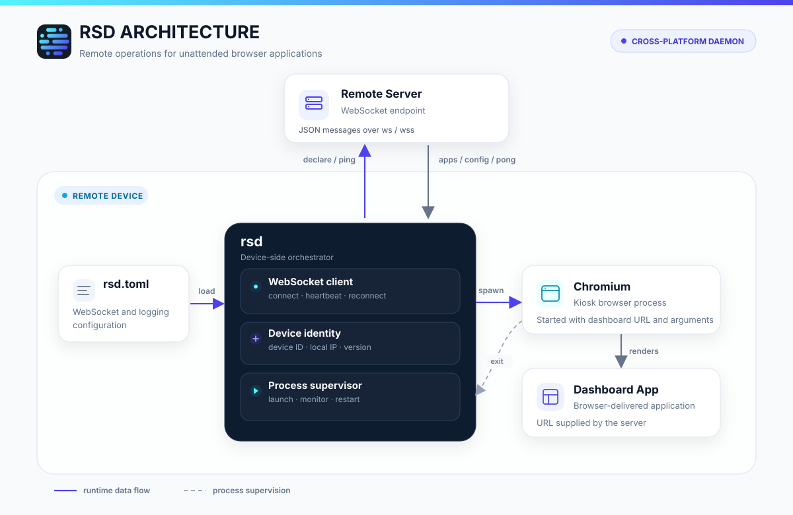

<div align="center">


### A cross-platform daemon for remote management and maintenance of browser-based apps and dashboards.

[](https://github.com/turingxlab/rsd/releases)
[](https://github.com/turingxlab/rsd/releases)
[](https://www.rust-lang.org/)
[](https://github.com/turingxlab/rsd/releases/latest)

<p align="center">
  <a href="./README.md"></a>
  <a href="./README_zh.md"></a>
</p>

</div>

## What is rsd?

`rsd` is a cross-platform daemon deployed on remote devices, primarily used for remote operations and maintenance of browser applications such as digital twins and visualization dashboards.

It maintains a WebSocket connection to the server, reports device information, and starts and manages browser applications according to the configuration delivered by the server.



## Core Capabilities

- **Device registration**: Reports the device ID, local IP address, and program version after connecting.
- **Stable connection**: Supports automatic reconnection and periodic heartbeats.
- **Remote application launch**: Receives application configuration from the server and starts the specified browser application.
- **Process supervision**: Monitors application status and restarts the application after it exits.
- **Cross-platform operation**: Supports Windows, macOS, and Linux.

If the application process exits unexpectedly, `rsd` retries startup up to 5 times. The retry count is reset after the application runs stably for 60 seconds.

## Quick Start

### Get the Program

Download the archive for your platform from [GitHub Releases](https://github.com/turingxlab/rsd/releases/latest). The extracted archive contains:

```text
rsd         # rsd.exe on Windows
rsd.toml
LICENSE
```

You can also build from source:

```bash
cargo build --release
```

The build output is located at:

```text
target/release/rsd
target/release/rsd.toml
```

### Configuration File

By default, `rsd` reads `rsd.toml` from the same directory as the executable.

```toml
[server]
# Server hostname or IP, without the scheme, port, or path
addr = "rsd.example.com"
port = 443
tls = true

[websocket]
path = "/ws/rsd/cmd"
reconnect_interval_sec = 30
heartbeat_enabled = true
heartbeat_interval_sec = 30

[logging]
level = "info"
```

Main configuration options:

| Option | Default | Description |
| --- | --- | --- |
| `server.addr` | Required | Server hostname or IP |
| `server.tls` | `true` | `true` uses `wss`; `false` uses `ws` |
| `server.port` | `443` / `80` | Defaults to 443 with TLS enabled, or 80 with TLS disabled |
| `websocket.path` | `/device/rsd/cmd` | WebSocket path |
| `websocket.reconnect_interval_sec` | `30` | Reconnection interval in seconds |
| `websocket.heartbeat_enabled` | `true` | Whether to send heartbeats |
| `websocket.heartbeat_interval_sec` | `30` | Heartbeat interval in seconds |
| `logging.level` | `info` | Log level |

Local debugging connection example:

```toml
[server]
addr = "127.0.0.1"
port = 8080
tls = false
```

### Start

When the configuration file and executable are in the same directory:

```bash
# Linux / macOS
./rsd
```

```powershell
# Windows
.\rsd.exe
```

To specify another configuration file:

```bash
# Linux / macOS
./rsd -c /etc/rsd/rsd.toml
```

```powershell
# Windows
.\rsd.exe -c C:\rsd\rsd.toml
```

After starting, `rsd` connects to the server. Pressing `Ctrl+C` stops the currently managed application before `rsd` exits.

For production deployments, run `rsd` as a system service (for example, systemd on Linux or a Windows Service), so it starts at boot and is restarted automatically if the process exits.

## Server Integration Guide

### Connection URL

`rsd` constructs the WebSocket URL from the client configuration:

```text
ws(s)://<server.addr>:<server.port><websocket.path>
```

For example:

```text
wss://rsd.example.com:443/ws/rsd/cmd
```

When `server.tls = true`, `wss` is used; when `false`, `ws` is used. `server.addr` contains only the hostname or IP, without the scheme, port, or path.

### Message Format

The client and server exchange UTF-8 JSON through WebSocket text frames. All messages use a common envelope:

```json
{
  "cmd": "declare",
  "timestamp": 1792921844000,
  "data": {}
}
```

- `cmd`: Message type, using snake_case.
- `timestamp`: Required Unix timestamp in milliseconds.
- `data`: Message payload, included depending on `cmd`.

### Message Types

| Direction | `cmd` | `data` | Description |
| --- | --- | --- | --- |
| rsd → server | `declare` | Device information | Sent immediately after connecting or reconnecting |
| rsd → server | `ping` | None | Sent at the heartbeat interval |
| server → rsd | `pong` | None | Heartbeat response; the client only writes a debug log |
| server → rsd | `apps` | Apps configuration | Delivers launchers and the application list |
| server → rsd | `config` | Arbitrary JSON | Currently only writes a debug log and does not change runtime configuration |

After connecting, `rsd` sends a device declaration message:

```json
{
  "cmd": "declare",
  "timestamp": 1792921844000,
  "data": {
    "device_id": "0123456789ABCDEF",
    "ip": "192.168.1.10",
    "version": "0.1.0"
  }
}
```

| Field | Type | Description |
| --- | --- | --- |
| `device_id` | string | Unique device identifier derived from the original hardware or system identifier; 16 uppercase hexadecimal characters |
| `ip` | string | Local IP address; `127.0.0.1` when detection fails |
| `version` | string | `rsd` program version |

Heartbeat messages do not include `data`:

```json
{
  "cmd": "ping",
  "timestamp": 1792921844000
}
```

The server may respond with:

```json
{
  "cmd": "pong",
  "timestamp": 1792921844000
}
```

The server should send parseable JSON text frames. Messages with an unknown `cmd`, a missing required `timestamp`, or invalid JSON are ignored by the client and logged as warnings.

The current protocol has no version field, additional WebSocket handshake authentication headers, or Apps processing acknowledgements. If authentication is required, it should be handled by a reverse proxy or at the network layer.

## Apps Configuration Data Structure

The `data` field of an `apps` message corresponds to the `AppConfig` structure:

```json
{
  "cmd": "apps",
  "timestamp": 1792921844000,
  "data": {
    "launchers": [
      {
        "launcher_id": "chromium",
        "path": "/usr/bin/chromium",
        "version": "1.0.0"
      }
    ],
    "applications": [
      {
        "app_id": "dashboard",
        "app_name": "Data Dashboard",
        "app_type": "browser",
        "version": "1.0.0",
        "url": "http://127.0.0.1:8081/dashboard",
        "args": [
          "--kiosk",
          "--hide-crash-restore-bubble"
        ],
        "launcher_id": "chromium",
        "active": true
      }
    ]
  }
}
```

All fields below are required and cannot be omitted from the JSON. `launchers` and `applications` may be empty arrays.

### AppConfig

| Field | Type | Description |
| --- | --- | --- |
| `launchers` | array | List of available launchers |
| `applications` | array | List of applications |

### Launcher

| Field | Type | Description |
| --- | --- | --- |
| `launcher_id` | string | Unique launcher identifier used to associate it with applications |
| `path` | string | Path to the launcher executable |
| `version` | string | Launcher version |

### Application

| Field | Type | Description |
| --- | --- | --- |
| `app_id` | string | Unique application identifier |
| `app_name` | string | Application name |
| `app_type` | string | Application type; currently only `browser` is supported |
| `version` | string | Application version |
| `url` | string | URL accessed by the browser application |
| `args` | string[] | Additional arguments passed to the launcher |
| `launcher_id` | string | Identifier of the corresponding launcher |
| `active` | boolean | Whether this is the active application |

### Common Launch Arguments

The `args` in the example use the following Chromium arguments:

- `--kiosk`: Launches the browser in full-screen kiosk mode, suitable for unattended dashboard displays.
- `--hide-crash-restore-bubble`: Suppresses the restore-session prompt on the next launch after the browser exits unexpectedly or its process is forcefully terminated.

The `/usr/bin/chromium` path in the example is a common Linux path. In an actual deployment, adjust `launcher.path` for the operating system and Chromium installation location.

The client selects the first application with `active = true` and looks up the corresponding launcher by `launcher_id`. The actual execution command is:

```text
<launcher.path> <application.url> <application.args...>
```

The launcher runs directly as a child process without a shell. If there is no active application, the client stops the currently managed application. If no launcher matches the active application's `launcher_id`, processing of the Apps configuration fails and the existing application process remains unchanged.
