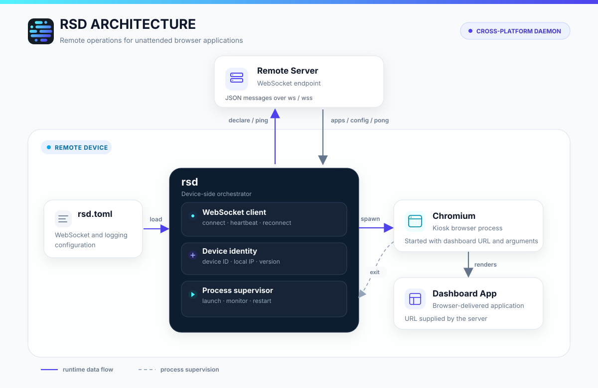

<div align="center">


### 一个用于浏览器应用和看板远程管理运维的跨平台守护进程。

[](https://github.com/turingxlab/rsd/releases)
[](https://github.com/turingxlab/rsd/releases)
[](https://www.rust-lang.org/)
[](https://github.com/turingxlab/rsd/releases/latest)

<p align="center">
  <a href="./README.md"></a>
  <a href="./README_zh.md"></a>
</p>

</div>

## 什么是 rsd？

`rsd` 是一个部署在远程设备上的跨平台守护进程，主要用于数字孪生、可视化大屏等浏览器应用的远程运维。

它通过 WebSocket 与服务端保持连接，上报设备信息，并根据服务端下发的配置启动和管理浏览器应用。



## 核心能力

- **设备接入**：连接后上报设备 ID、本机 IP 和程序版本。
- **稳定连接**：支持自动重连和周期心跳。
- **远程启动应用**：接收服务端下发的应用配置，启动指定的浏览器应用。
- **进程守护**：监测应用运行状态，应用退出后自动重启。
- **自更新**：接收服务端下发的版本信息，校验后替换自身并自动重启。
- **跨平台运行**：支持 Windows、macOS 和 Linux。

如果应用进程意外退出，`rsd` 最多重试启动 5 次；稳定运行 60 秒后，重试次数会清零。

## 快速开始

### 获取程序

从 [GitHub Releases](https://github.com/turingxlab/rsd/releases/latest) 下载对应平台的压缩包。解压后包含：

```text
rsd         # Windows 下为 rsd.exe
rsd.toml
LICENSE
```

### 配置文件

默认读取可执行文件同目录下的 `rsd.toml`。

```toml
[server]
# 服务端主机名或 IP，不包含协议、端口和路径
addr = "rsd.example.com"
port = 443
tls = true

[websocket]
path = "/ws/rsd/cmd"
reconnect_interval_sec = 30
heartbeat_enabled = true
heartbeat_interval_sec = 30

[logging]
level = "info"
```

主要配置项：

| 配置项 | 默认值 | 说明 |
| --- | --- | --- |
| `server.addr` | 必填 | 服务端主机名或 IP |
| `server.tls` | `true` | `true` 使用 `wss`，`false` 使用 `ws` |
| `server.port` | `443` / `80` | TLS 开启时默认 443，关闭时默认 80 |
| `websocket.path` | `/device/rsd/cmd` | WebSocket 路径 |
| `websocket.reconnect_interval_sec` | `30` | 重连间隔，单位为秒 |
| `websocket.heartbeat_enabled` | `true` | 是否发送心跳 |
| `websocket.heartbeat_interval_sec` | `30` | 心跳间隔，单位为秒 |
| `logging.level` | `info` | 日志级别 |

本地调试连接示例：

```toml
[server]
addr = "127.0.0.1"
port = 8080
tls = false
```

### 启动

配置文件与可执行文件在同一目录时：

```bash
# Linux / macOS
./rsd
```

```powershell
# Windows
.\rsd.exe
```

指定其他配置文件：

```bash
# Linux / macOS
./rsd -c /etc/rsd/rsd.toml
```

```powershell
# Windows
.\rsd.exe -c C:\rsd\rsd.toml
```

启动后会连接服务端。按 `Ctrl+C` 退出时，`rsd` 会停止当前托管的应用。

## 服务端对接说明

### 连接地址

`rsd` 根据客户端配置组合出 WebSocket 地址：

```text
ws(s)://<server.addr>:<server.port><websocket.path>
```

例如：

```text
wss://rsd.example.com:443/ws/rsd/cmd
```

`server.tls = true` 时使用 `wss`，`false` 时使用 `ws`。`server.addr` 只包含主机名或 IP，不包含协议、端口和路径。

### 消息格式

客户端和服务端通过 WebSocket 文本帧交换 UTF-8 JSON。所有消息使用统一信封：

```json
{
  "cmd": "declare",
  "timestamp": 1792921844000,
  "data": {}
}
```

- `cmd`：消息类型，使用 snake_case。
- `timestamp`：必填，Unix 毫秒时间戳。
- `data`：消息负载，根据 `cmd` 决定是否携带。

### 消息类型

| 方向 | `cmd` | `data` | 说明 |
| --- | --- | --- | --- |
| rsd → 服务端 | `declare` | 设备信息 | 建立连接和重连成功后立即发送 |
| rsd → 服务端 | `ping` | 无 | 按心跳间隔发送 |
| 服务端 → rsd | `pong` | 无 | 心跳响应，客户端仅记录调试日志 |
| 服务端 → rsd | `apps` | Apps 配置 | 下发启动器和应用清单 |
| 服务端 → rsd | `config` | 任意 JSON | 当前仅记录调试日志，不会修改运行配置 |
| 服务端 → rsd | `update` | 更新信息 | 下载并校验新版本，替换后自动重启 |

连接成功后，`rsd` 发送设备声明消息：

```json
{
  "cmd": "declare",
  "timestamp": 1792921844000,
  "data": {
    "device_id": "0123456789ABCDEF",
    "ip": "192.168.1.10",
    "version": "0.1.1",
    "os": "linux",
    "arch": "x86_64"
  }
}
```

| 字段 | 类型 | 说明 |
| --- | --- | --- |
| `device_id` | string | 设备唯一标识，由原始硬件或系统标识计算得到，共 16 位大写十六进制字符 |
| `ip` | string | 本机 IP 地址，探测失败时为 `127.0.0.1` |
| `version` | string | `rsd` 程序版本 |
| `os` | string | 操作系统名称，取自 Rust 的 `std::env::consts::OS` |
| `arch` | string | CPU 架构名称，取自 Rust 的 `std::env::consts::ARCH` |

心跳消息不携带 `data`：

```json
{
  "cmd": "ping",
  "timestamp": 1792921844000
}
```

服务端可回复：

```json
{
  "cmd": "pong",
  "timestamp": 1792921844000
}
```

服务端可发送自更新消息。`url` 必须指向当前操作系统的裸可执行文件，`sha256` 为 64 位十六进制摘要：

```json
{
  "cmd": "update",
  "timestamp": 1792921844000,
  "data": {
    "version": "0.2.0",
    "target": "x86_64-unknown-linux-gnu",
    "url": "https://example.com/rsd-linux-x86_64",
    "sha256": "0123456789abcdef0123456789abcdef0123456789abcdef0123456789abcdef"
  }
}
```

客户端会先将 `target` 与自身 Rust target 三元组进行严格比较；不匹配时只记录日志，不下载更新。客户端仅在目标版本高于当前版本时下载。下载文件通过 SHA-256 校验后才会替换当前可执行文件；成功后停止托管应用并自动重启到新版本。下载、校验或替换失败时记录错误并继续运行旧版本。服务端应结合 `declare` 中的 `os`、`arch` 选择正确的 target 和下载地址。

服务端应发送可解析的 JSON 文本帧。未知 `cmd`、缺少必填 `timestamp` 或无法解析的消息会被客户端忽略并记录警告。

当前协议没有版本字段、额外的 WebSocket 握手鉴权头和 Apps 处理回执。服务端如需鉴权，应在反向代理或网络层处理。

## Apps 配置数据结构

`apps` 消息的 `data` 对应 `AppConfig` 结构：

```json
{
  "cmd": "apps",
  "timestamp": 1792921844000,
  "data": {
    "launchers": [
      {
        "launcher_id": "chromium",
        "launcher_name": "Chromium",
        "path": "/usr/bin/chromium",
        "version": "1.0.0"
      }
    ],
    "applications": [
      {
        "app_id": "dashboard",
        "app_name": "数据大屏",
        "app_type": "browser",
        "version": "1.0.0",
        "url": "http://127.0.0.1:8081/dashboard",
        "args": [
          "--kiosk"
        ],
        "launcher_id": "chromium",
        "active": true
      }
    ]
  }
}
```

以下字段均为必填，JSON 中不能省略；`launchers` 和 `applications` 可以是空数组。

### AppConfig

| 字段 | 类型 | 说明 |
| --- | --- | --- |
| `launchers` | array | 可用启动器列表 |
| `applications` | array | 应用列表 |

### Launcher

| 字段 | 类型 | 说明 |
| --- | --- | --- |
| `launcher_id` | string | 启动器唯一标识，用于与应用关联 |
| `launcher_name` | string | 启动器名称 |
| `path` | string | 启动器可执行文件路径 |
| `version` | string | 启动器版本 |

### Application

| 字段 | 类型 | 说明 |
| --- | --- | --- |
| `app_id` | string | 应用唯一标识 |
| `app_name` | string | 应用名称 |
| `app_type` | string | 应用类型，当前只支持 `browser` |
| `version` | string | 应用版本 |
| `url` | string | 浏览器应用访问地址 |
| `args` | string[] | 传递给启动器的额外参数 |
| `launcher_id` | string | 对应的启动器标识 |
| `active` | boolean | 是否为当前活动应用 |

### 常用启动参数

示例中的 `args` 使用了以下 Chromium 参数：

- `--kiosk`：以全屏模式启动浏览器，适合无人值守大屏展示。

示例中的 `/usr/bin/chromium` 是 Linux 常见路径，实际部署时应按操作系统和 Chromium 安装位置调整 `launcher.path`。

客户端选择第一个 `active = true` 的应用，并通过 `launcher_id` 查找对应启动器。实际执行方式为：

```text
<launcher.path> <application.url> <application.args...>
```

启动器直接以子进程方式运行，不经过 shell。没有活动应用时，客户端会停止当前托管的应用；活动应用的 `launcher_id` 找不到对应启动器时，本次 Apps 配置处理失败，现有应用进程保持不变。
